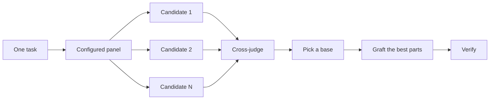

# Design before you write code

One attempt at a hard design locks in the first shape the model thought of. `/architect` settles types and boundaries before implementation. `/arena` runs several attempts at the same brief and merges the best parts. `/interrogate` has other models try to break the result. When the job is coverage rather than design synthesis, `/swarm` fans out slices or races and aggregates their results.

The two most common design mistakes are taking the agent's first design and polishing a plan that no code has tested. This page fixes both. You plan through code. Prototypes answer the open questions, a README or tutorial sets the target, and the written plan comes last.


## Plan a feature with Tech-leader

Use `/tech-leader <feature>` directly, or `/gt36-mode tech-leader <feature>`, when you want the proposal and implementation plan together. The playbook restores context with recall, sharpens the brief, uses architect and its nested arena to compare designs, then uses figure-it-out only to plan and teach only to explain the supplied findings. It applies design-space exploration and Laziness Protocol throughout.

It saves one document at `docs/designs/<feature-slug>.md` with the brief, actual project precedents, API contract fit or gaps, alternatives, proposed architecture, ordered implementation units, verification criteria, risks, and decisions waiting on you. Necessary prototype code stays temporary; the application and its test artifacts stay unchanged. Plan-only does not build a harness or execute any units. Teach does not restart a full investigation when findings already exist.

Architect's pending approval does not block writing the rest of this planning document, but it still blocks production implementation. Review the combined document before a later execution request. General approval does not accept an unstated contract fallback or authorize unspecified test changes. The [Tech-leader playbook](../../skills/gt36-mode/playbooks/tech-leader.md) defines the handoff. For larger program or stacked-PR plans, use Multi-phase plan instead.

## Settle the shape with `/architect`

```text
/architect design the import pipeline before writing any code. i care most about how callers use it.
```

[`/architect`](../../skills/architect/SKILL.md) grounds itself first, running `/explainer` over the code the design touches and `/investigator` when it moves ownership or layers. Then it runs `/arena` to produce competing design sketches, with the caller's usage written first in each, followed by types, signatures, and a module map.

Architect saves one reviewable document at `docs/designs/<task-slug>.md`. It contains caller usage, API and type sketches, module ownership and data flow, alternatives and tradeoffs, open decisions, implementation units, and verification criteria. Code sketches stay in the document or temporary candidate directories. It does not change application source, tests, or configuration.

It always stops and waits for your explicit approval. This applies inside gt36-mode, delegated work, and overnight runs too. Saying "build this" before the design exists does not approve the eventual design. The older checkpoint wording still works, but approval is now mandatory.

## Build the approved design with `/applier`

After reviewing the document, approve the presented version and ask for implementation:

```text
/applier docs/designs/import-pipeline.md. i approve this version of the design.
```

[`/applier`](../../skills/applier/SKILL.md) rereads the current code, implements small verifiable units, and checks real behavior against the design. It keeps the model role chosen by its caller, or the current model when called directly. It adds no commit, PR, or merge step; the enclosing workflow owns delivery.

Simple local work with a settled shape needs no design ceremony:

```text
/applier fix the typo in the empty-state label. keep its behavior and layout unchanged.
```

If a request still needs a material decision about API, shared-state ownership, or module boundaries, applier routes to architect and waits for your approval before coding. An unapproved design cannot be bypassed by calling the same task simple.

The design isn't sacred once code starts. If implementation repeatedly needs workarounds, forced casts, or unplanned ownership changes, applier stops affected work and sends the evidence back to architect. The revised document needs your approval again before implementation resumes. Ordinary internal details within the approved contract do not require another design round.

## Fan out attempts with `/arena`

```text
/arena take my prompt to the arena verbatim. i want to compare their proposals with yours.
```

[`/arena`](../../skills/arena/SKILL.md) is the general tool underneath. N subagents attempt the same design or code brief in parallel, each writing to its own worktree or directory. A read-only judge from a different model family scores every candidate against a rubric. When no model from another family can run, the coordinator skips the judge and picks the base itself. The coordinator reads each candidate end to end, picks a base, grafts in the best ideas from the losers, and verifies the result.



The panel comes from your [`/setup-gt36`](../../skills/setup-gt36/SKILL.md) configuration, and you can adjust it per task. Ask for more candidates when the decision matters, fewer when it doesn't:

```text
/arena this, 5 candidates. the cache key format is expensive to change later.
```

## Cover slices and races with `/swarm`

```text
/swarm check every package under packages/ against its check.sh. one worker per package. one report.
```

[`/swarm`](../../skills/swarm/SKILL.md) fans N workers across independent slices, coverage matrices, gauntlet lanes, exploration partitions, or declared race arms. Each worker gets its own scope and check, then reports `PASS`, `ISSUES`, or `BLOCKED`. The parent waits for the workers and returns one compact report with any gaps or dropouts.

Reach for it when parallelism buys coverage or lets independent checks race. `/arena` gives every worker the same design or code brief, then picks a base and grafts the best parts. `/swarm` covers slices or runs a race with a selection rule declared up front. It does not use the base-selection and grafting ceremony.

## Break it with `/interrogate`

```text
/interrogate the whole branch, but skeptically. no nitpicks unless it's an actual bug or regression.
```

[`/interrogate`](../../skills/interrogate/SKILL.md) gives the change and its intent to adversaries on the configured models, and each tries to break it with a run against the real code. Adversaries find different failures. A finding survives only when rerunning its command shows a failure that breaks the intent. The report lists every verified finding with the adversaries that found it, then what each adversary dropped and why, and applies nothing.

Read the Dropped list too. You can override the verdict.

## Prototype instead of debating

Never take the first design. Ask for a few, and pick from evidence you can see:

```text
/gt36-mode prototype a few options for the new dropdown menu. take screenshots or videos for me to compare.
```

The [Prototype playbook](../../skills/gt36-mode/playbooks/prototype.md) builds throwaway sketches in a scratch directory, puts the variants behind one switcher, drives each one, and captures screenshots or timings. It also works for behavior and algorithms, not just UI. Prototypes are planning with code. They let the agent answer its own open questions by running something instead of asking you, and they leave room for an option you wouldn't have thought of.

The same idea scales up to a real design. Pair `/architect` with prototypes and keep a review gate:

```text
/gt36-mode we need rate limiting for external webhooks. /architect it first, and answer open questions with prototypes. let me review before proceeding.
```

Don't spend adversaries on an abstract plan. `/interrogate` drops every finding a run does not prove, so a plan with no code behind it gives them little to break. Let prototypes settle the questions, then review what got built.

## Write the README first for shared code

For a package or API that other code will use, start with the doc a user would read:

```text
/gt36-mode write a tutorial for how i would use the new config package first. then /teach me why it beats the current one.
```

Writing the tutorial first forces the caller's view. You describe the API to a hypothetical user and work back to the implementation. The doc also becomes a concrete target the agent checks its own work against. Name [`/technical-writing`](../../skills/technical-writing/SKILL.md) when the doc itself matters, so a tutorial stays a tutorial instead of drifting into reference and explanation at once.

## Plan after the design settles

gt36 has no planning skill, on purpose. When you do want a written plan, ask for it once the design is settled:

```text
/gt36-mode turn this design into a plan. small verifiable PRs, each with its own verification steps.
```

The [Multi-phase plan playbook](../../skills/gt36-mode/playbooks/multi-phase-plan.md) settles any remaining open questions by prototype, then writes one section per PR, each ending in proof that the change works. A passing test suite alone doesn't count as that proof. The plan is the deliverable. The playbook doesn't implement it, and it names which execution playbook should run it next.

For a migration, state the bar in the prompt:

```text
/gt36-mode plan the migration of our ui library to the new styling system. small verifiable PRs, each with visual regression checks. the result must match the original exactly, bugs included.
```

"bugs included" keeps the migration from quietly fixing things on the way, which would make the old and new output impossible to compare. For a project that spans many days, you can commit the plan to the repo for a while so other agents see the work in progress. Delete it when the work lands.

## How much design work does a task deserve?

You might be wondering whether every change needs this. No. Most changes need none of it. A rough ladder:

- A small, finished change you're unsure about needs `/interrogate` alone.
- A change that needs a new architecture across function boundaries or ownership earns `/architect`, which brings `/arena` and a mandatory human review before `/applier` with it. Mechanical edits within a settled contract can use `/applier` directly.
- A standalone decision where independent attempts would help, like naming, formats, or an algorithm, is `/arena` directly.
- A coverage matrix, set of parallel checks, or race with declared arms is `/swarm`.
- An open question you could answer by running something, like a layout, a timing, or an approach, gets a prototype, not a debate.
- A contested design that's expensive to reverse gets `/architect`, then `/interrogate` before shipping.
- Work that spans several PRs gets a plan, written after the design settles.

`/gt36-mode` already applies this ladder. New architectural decisions across boundaries trigger `/architect` and its approval gate, so you reach for these directly mainly when you want more or less scrutiny than the default.

After approving the architecture, continue with applier or the enclosing delivery playbook.

Next: [Build and clean the change](./05-build-and-clean.md).
